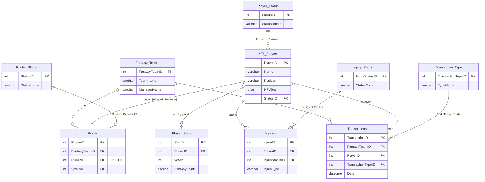

# Fantasy Football League Database (MySQL + Python)

A MySQL database for one fantasy football league: teams, rosters, weekly player scoring, waiver-wire status, injuries and add/drop transactions. It includes sample data from a real 12-team league (2025 season, Weeks 1-5), ten example queries and a small Python script that runs four of them.

Semester project for a graduate database systems course (COMP 544, Grove City College, Fall 2025).

## Schema

Ten tables: four main tables, one stats table and four lookup tables. Status values live in lookup tables instead of `ENUM`s, so foreign keys keep them consistent.



## Running it

Needs MySQL 8.0+.

```bash
mysql -u root -p < sql/01_create_schema.sql     # creates FantasyFootballDB and all tables
mysql -u root -p < sql/02_insert_data.sql       # loads the sample league
mysql -u root -p < sql/03_example_queries.sql   # runs queries a-j
```

For the Python script, run `pip install -r python/requirements.txt`, then `python python/ff_queries.py`. It connects as `root` on localhost by default. Override with the `FF_DB_USER`, `FF_DB_PASSWORD`, `FF_DB_HOST` and `FF_DB_NAME` environment variables.

## Notes

- Sample data comes from a Yahoo fantasy league export and FantasyPros weekly scoring. The other eleven managers' names are replaced with placeholders. It's third-party data, included for demonstration only.
- Known bug: `ff_queries.py` looks for position `'DEF'`, but the data uses `'DST'`, so defenses are left out of the "maximum possible points" calculation.
